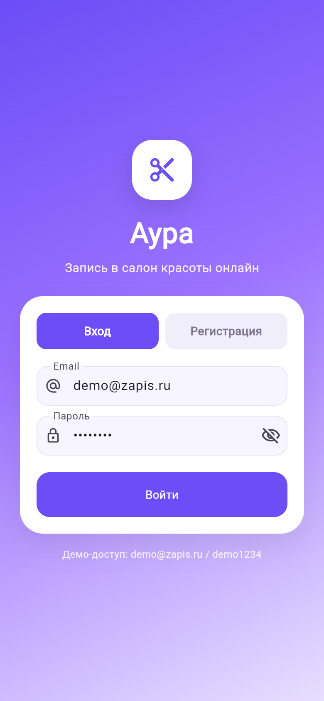
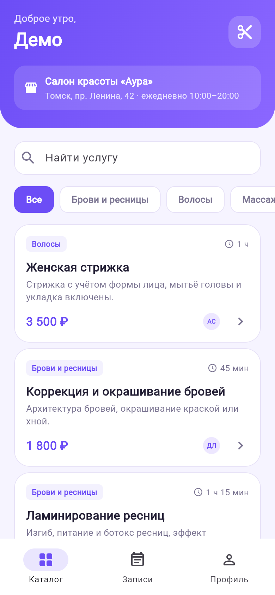
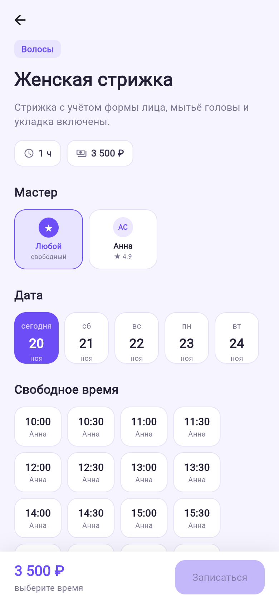
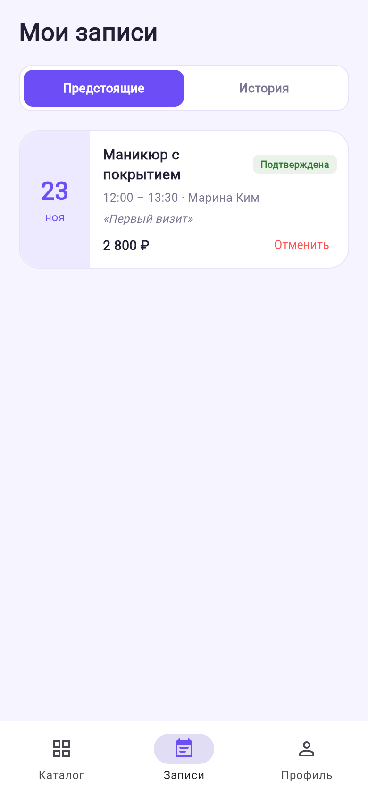
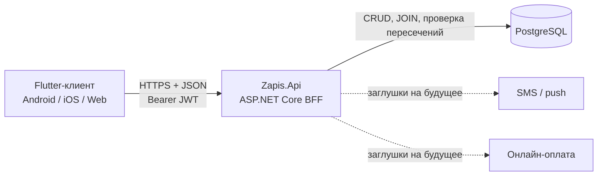
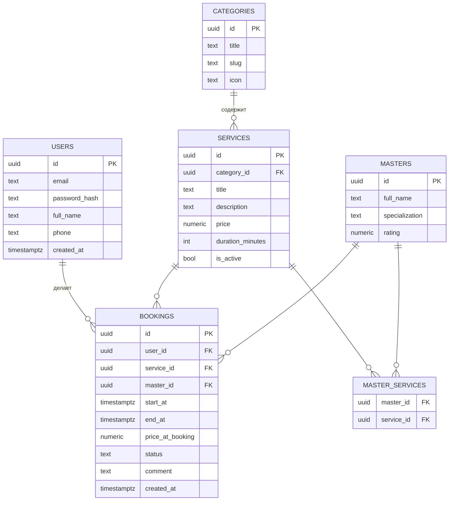

# «Аура» — запись в салон красоты

Демонстрационный full-stack проект: мобильный клиент на **Flutter** и лёгкий **REST API на C# (.NET)**,
который обслуживает только это приложение (BFF), плюс продакшн-схема **PostgreSQL**.

Сделан как pet-проект под вакансию Junior FullStack (Flutter + C#/Java + PostgreSQL): показать,
что я умею пройти путь «контракт API → база → клиент» целиком.

> Одна фраза: клиент салона смотрит каталог услуг, выбирает мастера и свободное окно,
> записывается и отменяет запись; сервер валидирует всё это и не даёт записаться дважды.

---

## Что реализовано

**Backend**
- регистрация и вход по email/паролю, JWT (HS256), PBKDF2-хеширование паролей;
- каталог: категории, поиск, пагинация;
- карточка услуги: описание, цена, длительность, список мастеров (many-to-many);
- свободные слоты на 10 дней вперёд с учётом занятости мастера и рабочего графика;
- создание записи с защитой от двойного бронирования (409 Conflict);
- отмена записи, разделение на предстоящие/прошедшие;
- профиль: чтение и обновление;
- ошибки в формате RFC 7807 (`application/problem+json`), валидация DTO;
- CORS для Flutter Web и отладки.

**Frontend**
- вход/регистрация, сохранение токена между запусками;
- каталог с фильтром по категориям и поиском (debounce);
- карточка услуги: выбор мастера, даты и времени;
- «Мои записи»: предстоящие и история, отмена с подтверждением;
- профиль: редактирование, выход;
- состояния загрузки, ошибки и пустые состояния, pull-to-refresh.

---

## Скриншоты

| Вход | Каталог услуг |
|---|---|
|  |  |

| Услуга, мастера и свободные окна | Мои записи |
|---|---|
|  |  |

---

## Стек

| Слой | Технологии |
|---|---|
| Мобильный клиент | Flutter 3.41 / Dart 3.11, Material 3, `provider`, `http`, `shared_preferences` |
| Backend | C# / .NET 10, ASP.NET Core Minimal API, собственные JWT и PBKDF2 (без сторонних пакетов) |
| База данных | PostgreSQL 16 — целевая схема (`database/schema.sql`); в демо-режиме — JSON-хранилище |
| Инструменты | `dotnet` CLI, `flutter analyze`, REST Client (`.http`), Docker Compose |

---

## Архитектура



Почему BFF, а не «полноценный» бэкенд: сервис обслуживает только одно мобильное приложение,
поэтому в нём нет лишних слоёв — контроллеры/эндпоинты, сервисы с бизнес-правилами,
тонкий слой доступа к данным. Такую же структуру легко расширять до отдельных микросервисов,
когда появится второй потребитель.

---

## Структура репозитория

```
booking-app/
├── backend/
│   └── Zapis.Api/          # REST API на C#
│       ├── Domain/         # сущности, DTO, маппинг
│       ├── Endpoints/      # группы эндпоинтов (auth, catalog, bookings, profile)
│       ├── Infrastructure/ # JWT, хеши паролей, хранилище, демо-данные
│       ├── Services/       # график салона и расчёт свободных слотов
│       └── Zapis.Api.http  # примеры запросов
├── client/                 # Flutter-приложение
│   └── lib/
│       ├── core/           # API-клиент, модели, состояние авторизации, форматирование
│       └── screens/        # вход, каталог, услуга, записи, профиль
├── database/
│   ├── schema.sql          # DDL для PostgreSQL
│   └── queries.sql         # примеры SELECT / JOIN / INSERT / UPDATE
├── docs/
│   └── otvet-rabotodatelyu.md
└── docker-compose.yml      # PostgreSQL для локальной разработки
```

---

## Быстрый старт

Нужны .NET SDK 10 и Flutter 3.41+.

### 1. Backend

```bash
cd backend/Zapis.Api
dotnet run
```

API поднимется на `http://localhost:5099`:

- `GET /health` — проверка живости;
- `GET /` — карта эндпоинтов.

При первом запуске создаётся `App_Data/db.json` с демо-данными
(салон «Аура»: 4 категории, 4 мастера, 10 услуг) и тестовым пользователем:

```
demo@zapis.ru / demo1234
```

Проверка:

```bash
curl http://localhost:5099/api/services
curl -X POST http://localhost:5099/api/auth/login \
  -H "Content-Type: application/json" \
  -d '{"email":"demo@zapis.ru","password":"demo1234"}'
```

### 2. Клиент

```bash
cd client
flutter pub get
flutter run              # Android / iOS
flutter run -d chrome    # веб-версия
```

Адрес API по умолчанию:

| Платформа | Адрес |
|---|---|
| Android-эмулятор | `http://10.0.2.2:5099` |
| iOS-симулятор, Web, десктоп | `http://127.0.0.1:5099` |

Для реального устройства укажите адрес компьютера в сети:

```bash
flutter run --dart-define=API_BASE_URL=http://192.168.0.5:5099
```

---

## API

Все ответы — JSON (camelCase), ошибки — `application/problem+json`.
Эндпоинты с 🔒 требуют заголовок `Authorization: Bearer <token>`.

| Метод | Путь | Назначение |
|---|---|---|
| `POST` | `/api/auth/register` | регистрация, возвращает токен и профиль |
| `POST` | `/api/auth/login` | вход, возвращает токен и профиль |
| `GET` | `/api/auth/me` 🔒 | текущий пользователь |
| `GET` | `/api/categories` | список категорий |
| `GET` | `/api/services?q=&categoryId=&page=&pageSize=` | каталог с поиском и пагинацией |
| `GET` | `/api/services/{id}` | карточка услуги с мастерами |
| `GET` | `/api/services/{id}/slots?date=2026-11-21&masterId=` | свободные окна на дату |
| `POST` | `/api/bookings` 🔒 | создать запись |
| `GET` | `/api/bookings?scope=upcoming\|past\|all` 🔒 | мои записи |
| `POST` | `/api/bookings/{id}/cancel` 🔒 | отменить запись |
| `GET` | `/api/profile` 🔒 | профиль |
| `PUT` | `/api/profile` 🔒 | обновить имя и телефон |

Пример создания записи:

```bash
TOKEN=$(curl -s -X POST http://localhost:5099/api/auth/login \
  -H "Content-Type: application/json" \
  -d '{"email":"demo@zapis.ru","password":"demo1234"}' | jq -r .token)

curl -X POST http://localhost:5099/api/bookings \
  -H "Authorization: Bearer $TOKEN" \
  -H "Content-Type: application/json" \
  -d '{"serviceId":"c1111111-1111-1111-1111-111111111111",
       "masterId":"b1111111-1111-1111-1111-111111111111",
       "startAt":"2026-11-21T04:30:00Z",
       "comment":"Первый раз"}'
```

Коды ответов: `201` — запись создана, `409` — время занято или запись уже отменена,
`401` — нет/просрочен токен, `422` — ошибка валидации полей.

---

## Модель данных



Решения, которые важно проговорить:

- **UUID вместо autoincrement** — id можно генерировать на клиенте/в нескольких сервисах, нет утечки объёма данных.
- **`timestamptz`** — время хранится в UTC, клиент показывает локальное; расписание салона задаётся в его часовом поясе.
- **`price_at_booking`** — фиксируем цену на момент записи, чтобы изменение прайса не переписывало историю.
- **`MASTER_SERVICES`** — many-to-many: один мастер оказывает несколько услуг, одну услугу делают несколько мастеров.
- **Защита от пересечений** — на уровне приложения (проверка в транзакции) и на уровне БД
  (`EXCLUDE USING gist` в `database/schema.sql`), чтобы гонка двух запросов не создала две записи на одно время.
- **Индексы** — `(master_id, start_at)` для проверки занятости, `(user_id, start_at desc)` для «моих записей».

---

## Как работает запись

1. Клиент открывает карточку услуги и запрашивает слоты на дату.
2. Сервер строит сетку от 10:00 до 20:00 с шагом 30 минут, вычитает занятые интервалы мастера
   и убирает прошедшее время.
3. Клиент отправляет `serviceId`, `masterId`, `startAt`.
4. Сервер проверяет: услуга активна, мастер её оказывает, время попадает в сетку,
   нет пересечения у мастера и у самого клиента. Только после этого создаёт запись.
5. Повторная запись на то же время → `409 Conflict`.

Проверка пересечений сделана на сервере намеренно: клиенту доверять нельзя,
а `EXCLUDE`-constraint в PostgreSQL закрывает и гонку параллельных запросов.

---

## Проверки, которые я прогнал

```bash
# backend
cd backend/Zapis.Api && dotnet build     # 0 ошибок, 0 предупреждений

# клиент
cd client && flutter analyze             # No issues found!
```

Сценарий вручную (curl): логин → каталог → слоты → создание записи → повторная запись (409) →
список записей → отмена. Всё отрабатывает.

---

## Ограничения демо и путь к PostgreSQL

Чтобы проект запускался одной командой **без Docker и без установки БД**, хранилище в демо —
потокобезопасный JSON-файл (`App_Data/db.json`). Это осознанное решение для pet-проекта,
а не «замена PostgreSQL».

Что уже готово под PostgreSQL:

- `database/schema.sql` — целевая схема с типами, FK, индексами и exclusion-constraint;
- `database/queries.sql` — реальные запросы: JOIN каталога, выборка моих записей,
  вставка записи с ценой из услуги, отмена, отчёт по мастерам;
- `docker-compose.yml` — поднять PostgreSQL 16 локально.

Как перейти (≈1 вечер):

1. Добавить пакеты `Npgsql.EntityFrameworkCore.PostgreSQL` и `Microsoft.EntityFrameworkCore.Design`.
2. Описать `ZapisDbContext` с конфигурацией сущностей (ключи, индексы, `EXCLUDE` через `HasCheckConstraint`/SQL).
3. Заменить класс `JsonDatabase` на `ZapisDbContext` — эндпоинты не меняются, потому что весь доступ
   к данным уже изолирован в одном месте.
4. `dotnet ef migrations add Initial` → `dotnet ef database update`.

---

## Что дальше (роадмап)

- push-уведомления о записи (FCM/APNs) и SMS-подтверждение;
- онлайн-оплата и предоплата;
- отзывы и рейтинги мастеров;
- админ-панель для расписания и прайса;
- интеграция с календарём мастера;
- тесты: xUnit для бизнес-логики слотов, widget-тесты Flutter;
- CI (GitHub Actions): `dotnet build`, `dotnet test`, `flutter analyze`, `flutter test`.

---

## Соответствие вакансии

| Требование | Где посмотреть |
|---|---|
| Dart / Flutter, Android + iOS | `client/` — 5 экранов, состояние, сеть, хранение токена |
| ООП и слои | `Domain` / `Services` / `Endpoints` / `Infrastructure` |
| REST API, контроллеры, DTO | `Endpoints/`, `Domain/Contracts.cs` |
| PostgreSQL: SELECT, INSERT, UPDATE, JOIN | `database/schema.sql`, `database/queries.sql` |
| Git | `.gitignore`, структура под git (инициализация: `git init && git add . && git commit -m "init"`) |
| Разобраться в чужом коде | проект написан с нуля по чужому ТЗ (эта вакансия) |
